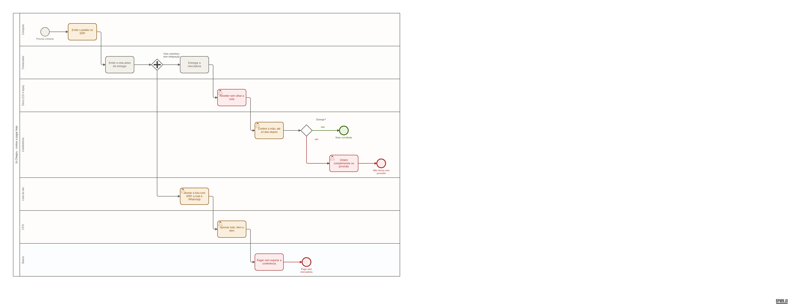
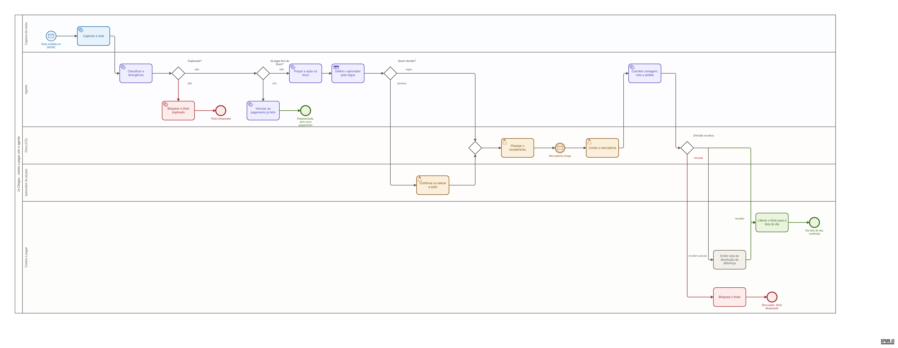

# O processo do contas a pagar

Dois diagramas em BPMN 2.0. Os arquivos `.bpmn` abrem no [bpmn.io](https://demo.bpmn.io) e no
Camunda Modeler. As imagens ao lado servem só para leitura rápida, e a página com os dois diagramas navegáveis está publicada como artefato ([Processo do contas a pagar](https://claude.ai/artifact/Tm2f4K6MuFoxHBBTSpqdhE)), gerada por `scripts/build_artifact.py` a partir de `artifacts/process/`. Os dois são gerados por
`scripts/generate_bpmn.py`: para mudar o desenho, mude o script e rode de novo.

## O processo atual

O pagar errado nasce no gateway paralelo depois da nota. A partir dali, dois caminhos correm
sem se falar:

- **o da mercadoria:** a doca recebe sem ter olhado a nota, e a conferência à mão vem depois,
  em até 14 dias;
- **o do dinheiro:** a nota entra na lista do dia, o CFO aprova item a item e o banco paga.

O pagamento não espera a conferência. Quando a divergência aparece, a mercadoria já foi
aceita, e aceitar a nota é aceitar o pedido. Nada é recuperado.

## O processo-alvo

A estratégia tem cinco escolhas, cada uma ligada a uma causa-raiz do pagar errado:

| Escolha | Onde aparece | Causa que ataca |
|---|---|---|
| **Conferir quando a nota é emitida**, antes do caminhão | A captura dispara o agente no evento "Nota emitida na SEFAZ" | O momento: hoje a conferência vem depois do aceite |
| **Duplicidade primeiro, e bloqueada na hora** | O gateway "Duplicada?" logo depois da classificação leva direto a "Bloquear o título duplicado", sem esperar caminhão | A exceção mais cara de errar: paga a nota inteira de novo |
| **O que já foi pago não paga de novo** | O gateway "Já paga fora do fluxo?" vincula a nota tardia ao pagamento da compra emergencial e fecha sem passar pela lista | A compra da loja paga por fora, que hoje volta a ser paga quando a nota chega |
| **O que bate passa direto** | O ramo "regra" de "Quem decide?" pula o aprovador | O meio: a conferência manual não escala com 11,4 mil notas por mês |
| **A pessoa só na exceção, pela régua** | "Confirmar ou alterar a ação", na raia do aprovador da alçada | O mandato: a decisão vai para quem tem alçada, e o CFO deixa de aprovar tudo |
| **O título só vai para a lista conferido** | Contas a pagar libera, devolve a diferença ou bloqueia depois da conciliação | A visibilidade e o dinheiro: nada é pago antes de o recebido bater |

Dois momentos de conferência, porque a informação chega em dois tempos:

1. **Antes da doca**, só com documentos: duplicidade, nota sem pedido, pago fora do fluxo,
   item sem cadastro, item trocado e unidade de medida. A doca recebe a ação proposta antes do
   caminhão ("Planejar o recebimento").
2. **Na doca, com o caminhão parado e antes do aceite**: falta física e quantidade menor só
   aparecem quando a mercadoria é contada. A doca conta, o agente concilia a contagem com a
   nota e o pedido, e **a doca decide**: receber, receber parcial (com nota de devolução da
   diferença) ou recusar (com o título bloqueado). A decisão vem antes do aceite porque, para
   o jurídico, aceitar a nota é aceitar o pedido.

## O que fica de fora do processo-alvo

**As lojas.** O processo-alvo cobre o CD primeiro: são 64% do valor das notas (1,9 mil por mês,
com média de R$ 11,8 mil) e o recebimento tem coletor. As lojas recebem 9,5 mil notas por mês,
com média de R$ 1,3 mil, e a divergência delas corre por WhatsApp. Elas entram numa segunda
fase, com a divergência registrada no app de recebimento.
